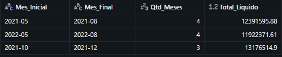

# Sales Analyses — SQL

## Contexto
Uma análise específica sobre uma base de vendas de um e-commerce

## Dataset
- Fonte: https://www.kaggle.com/datasets/datascikhan/e-commerce-sales-and-customer-analytics
- Tabela utilizada: `bank_customer_churn`

## Análise
- **Pedido:** Sequências de crescimento da receita. Mostrar quais foram as 3 maiores sequências de períodos em que a receita só subiu, mês após mês. O resultado deve trazer:
  - mês inicial da sequência;
  - mês final da sequência;
  - qtd de meses da sequência;
  - o total líquido acumulado da sequência;      

- **Técnicas:** Windows Functions, CTEs, JOINs

